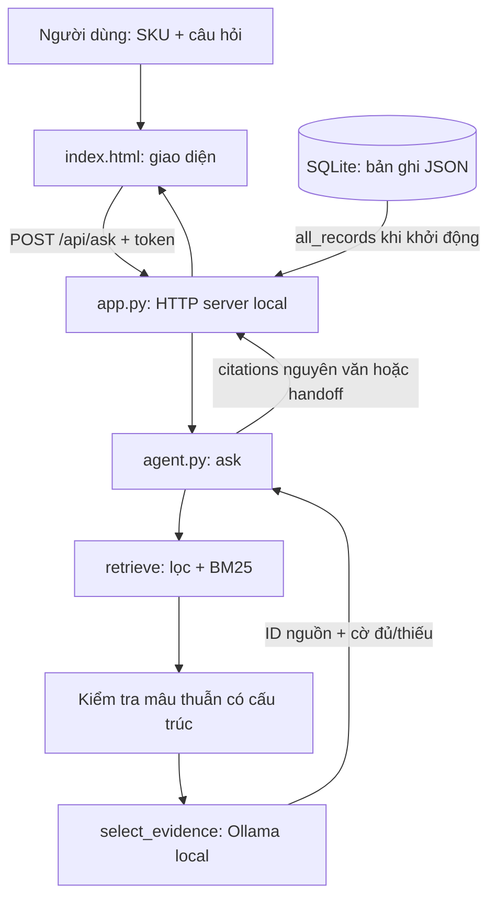
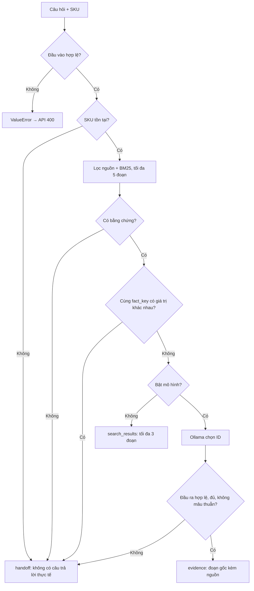
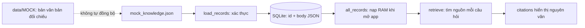

# Hướng dẫn source code — Local Support Agent

Bản hướng dẫn cho ứng dụng CSKH điện tử local, ngày 05/11/2026.
Mã nguồn được chú thích bằng các nhãn [A…], [B…], [C…]. Tìm nhãn trong trình soạn thảo để đến đúng phần. Các chú thích không thay đổi logic chương trình.

## 1. Chạy và đọc dự án

Trong Terminal:

```sh
cd /Users/hbliss/Documents/LocalSupportAgent
python3 app.py --port 8876
```

Mở http://127.0.0.1:8876. Có thể mở start.command trên Mac. Cần Ollama đang chạy với model Qwen:latest để bật kiểm tra bằng mô hình. Bỏ chọn ô mô hình để chỉ tìm tài liệu. Nếu cổng đang bị ứng dụng khác dùng, đổi --port; không cần tắt ứng dụng không liên quan.

Đọc theo thứ tự: hướng dẫn này → index.html → app.py → agent.py → dữ liệu mẫu → tests/test_agent.py. Bản HTML cùng tên hiển thị các sơ đồ ngay trong trình duyệt, không tải thư viện từ Internet.

## 2. Bản đồ tệp

| Tệp | Vai trò | Khi nào chỉnh sửa |
| --- | --- | --- |
| start.command | Chuyển vào thư mục dự án và chạy app ở cổng 8876 | Đổi cách khởi động |
| index.html | Giao diện, CSS và JavaScript gửi câu hỏi | Đổi giao diện, câu hỏi gợi ý |
| app.py | HTTP server local, kiểm tra yêu cầu, gọi RAG | Đổi cổng, thêm API hoặc xử lý phiên |
| agent.py | Nhập kho, tìm kiếm, chọn bằng chứng, từ chối | Đổi thuật toán truy xuất hoặc quy tắc trả lời |
| data/mock_knowledge.json | Tập dữ liệu đầu vào đã chia đoạn | Thêm sản phẩm và chính sách |
| data/knowledge.sqlite3 | Kho đã nhập để chương trình đọc | Dùng lệnh ingest, không sửa tay |
| data/MOCK/ | Bản văn bản đọc được của nguồn giả lập | Đối chiếu nội dung; không tự đồng bộ vào SQLite |
| tests/test_agent.py | 13 kiểm thử nền; tests/test_chat.py thêm 8 kiểm thử chat | Bổ sung trường hợp sai có thể xảy ra |
| postman/local-rag.postman_collection.json | 10 yêu cầu HTTP và 29 assertions | Kiểm tra toàn tuyến ứng dụng + Ollama |
| API.md | Hợp đồng API hiện có | Đối chiếu định dạng yêu cầu/phản hồi |
| VALIDATION.md | Bằng chứng kiểm thử và giới hạn | Đọc trước khi đánh giá độ tin cậy |

## 3. Sơ đồ tổng thể



Chú giải: mũi tên là dữ liệu/lời gọi; SQLite là kho trên đĩa; Ollama là tiến trình riêng. Trình duyệt không gọi Ollama trực tiếp. Nội dung hiển thị lấy từ bản ghi gốc, không lấy đoạn văn do mô hình tự soạn. Khi tắt mô hình, bỏ qua select_evidence và trả tối đa 3 kết quả tra cứu.

## 4. Luồng một câu hỏi



handoff hiện chỉ là trạng thái giao diện. Không có email, CRM hoặc ticket tự động. evidence nghĩa là mô hình đã chọn nguồn; không đồng nghĩa câu trả lời chắc chắn đúng.

## 5. agent.py — từng phần xử lý RAG

### [A1] Cấu hình

ROOT là thư mục chứa agent.py, nên có thể di chuyển cả dự án. DB trỏ tới data/knowledge.sqlite3. OLLAMA trỏ tới 127.0.0.1:11434/api/chat. STOP chứa từ phổ biến bị loại khi tìm kiếm. Không có API key cloud.

### [A2] tokens(text)

Đổi chữ thường → đ thành d → bỏ dấu Unicode → lấy chữ/số → bỏ từ trong STOP. Ví dụ “Bảo hành bao lâu?” còn các từ gần như “bao”, “hanh”, “lau”. Hàm này chỉ phục vụ tìm kiếm; nội dung nguồn trả cho khách vẫn giữ dấu và nguyên văn.

Lưu ý: STOP có “khong”. Vì vậy câu phủ định có thể mất sắc thái ở bước truy xuất. Mô hình vẫn nhận câu hỏi gốc, nhưng chỉ thấy các nguồn mà truy xuất đã chọn. Đây là điểm cần đánh giá trước khi dùng dữ liệu thật.

### [A3] load_records(path, db)

Đọc JSON dạng danh sách không rỗng. Kiểm tra trường bắt buộc là chuỗi, ID duy nhất, text không quá 5.000 ký tự, ngày hợp lệ và approved/mock là boolean. Sau khi kiểm tra toàn bộ, mở giao dịch SQLite, xóa bản ghi cũ rồi nhập tập mới. Đây là thay toàn bộ kho, không phải thêm nối.

Mỗi bản ghi đã là một đoạn tài liệu. Chưa có parser PDF/Excel, OCR, tự chia đoạn hoặc tự tạo embedding. fact_key/fact_value nên là chuỗi nhất quán; bản hiện tại chưa kiểm tra chặt kiểu của mọi trường tùy chọn.

### [A4] all_records(db)

Đọc cột body từ bảng records và chuyển JSON thành danh sách dictionary. Kho chưa tồn tại thì trả danh sách rỗng. app.py gọi một lần khi tạo server; mỗi câu hỏi dùng bản trong RAM. Sửa SQLite hoặc nhập JSON mới không tự cập nhật server đang chạy.

### [A5] retrieve(question, product, records, today)

1. Giữ bản ghi đúng product, approved=true, và valid_from ≤ ngày hiện tại ≤ valid_to.
2. Chuẩn hóa câu hỏi; loại các token thuộc mã sản phẩm đã chọn.
3. Ghép topic + keywords + text thành văn bản dùng để tìm kiếm.
4. Tách chủ đề theo “và”, “cũng như”, dấu chấm phẩy/dấu hỏi; bỏ cụm dẫn như “chính sách”. Ý hỏi có 1–2 token phải khớp hết; ý dài hơn cần tỷ lệ phủ ít nhất 0,45. Đoạn chỉ cần khớp một ý để được xét; tập nguồn phải phủ tất cả các ý hỏi.
5. Chấm BM25, sắp điểm giảm dần, lấy tối đa 5 đoạn.

BM25 ưu tiên từ ít phổ biến trong tập tài liệu và điều chỉnh theo độ dài đoạn. Trong code, k1=1,2 và b=0,75. Tỷ lệ phủ từ chỉ là điều kiện sàng lọc; không phải “độ tin cậy 45%”. Tập dùng tính tần suất từ chỉ gồm nguồn hợp lệ của SKU đã chọn.

Đây là tìm kiếm từ khóa có chuẩn hóa dấu, chưa là tìm kiếm ngữ nghĩa bằng vector. Ngày mặc định lấy từ hệ điều hành máy chạy; tham số today giúp kiểm thử tài liệu hết hạn.

### [A6] select_evidence(...)

Tạo JSON schema với ids chỉ được chọn trong enum ID của candidates. Hai cờ insufficient và conflict phải là boolean. Gửi câu hỏi gốc cùng các đoạn nguồn cho Ollama, stream=false, temperature=0, num_predict=250, num_ctx=8192; timeout mặc định 90 giây.

Prompt yêu cầu không suy diễn thông số/giá/tồn kho và không coi nội dung tài liệu là chỉ thị. Đây là hướng dẫn cho mô hình, không bảo đảm chống prompt injection. Ứng dụng bỏ proxy từ biến môi trường cho yêu cầu này và gọi endpoint local mặc định.

Sau khi nhận kết quả: kiểm tra done=true → parse message.content thành JSON → kiểm tra kiểu của trường bắt buộc → xác nhận ID thuộc danh sách nguồn. Schema cấm trường thừa ở phía mô hình; tầng Python hiện kiểm tra các trường cần thiết và ID, không kiểm tra riêng toàn bộ trường thừa. Văn bản mô hình tự tạo không được ghép vào câu trả lời cuối.

### [A7] ask(...)

Hàm điều phối chính. Kiểm tra câu hỏi 1–2.000 ký tự và product là chuỗi. SKU không tồn tại hoặc không tìm thấy nguồn thì trả handoff.

Với mỗi fact_key xuất hiện trong candidates, lấy mọi nguồn đang hiệu lực của SKU có cùng khóa. Nếu các fact_value khác nhau thì từ chối. Ví dụ warranty=12 tháng và warranty=24 tháng sẽ bị chặn. Không tự chọn tài liệu có ngày mới nhất. Mâu thuẫn văn xuôi không có khóa có thể chỉ được mô hình phát hiện, và không được bảo đảm.

Nếu bật mô hình: gọi select_evidence riêng cho mỗi chủ đề (tối đa 4), sau đó kiểm tra tập ID được chọn có phủ đủ các ý hỏi. Lỗi mạng, timeout, JSON sai, ID lạ đều được chuyển thành model_unavailable. Nếu mô hình báo thiếu hoặc mâu thuẫn thì handoff. Nếu hợp lệ, lọc danh sách bản ghi bằng các ID được chọn và trả nguyên bản ghi.

Nếu tắt mô hình: trả tối đa 3 đoạn với status=search_results. Giao diện nói rõ đó chỉ là tra cứu tham khảo.

### [A8] Chạy từ dòng lệnh

```sh
python3 agent.py ingest --file data/mock_knowledge.json
python3 agent.py ask --product LAP-A14 --question 'Bảo hành bao lâu?'
python3 agent.py ask --product LAP-A14 --question 'Bảo hành bao lâu?' --model Qwen:latest
```

Lệnh ask không có --model chỉ truy xuất tài liệu. Lệnh ingest thay kho và cần khởi động lại app đang mở.

## 6. app.py — server và API

| Nhãn | Thành phần | Giải thích |
| --- | --- | --- |
| B1 | make_server | Tạo token phiên, semaphore có sức chứa 1, đọc kho vào RAM |
| B2 | Handler.respond | Mã hóa JSON/HTML, đặt Content-Length và header no-store/nosniff/DENY |
| B3 | Handler.trusted | Chỉ nhận Host localhost hoặc 127.0.0.1 với đúng cổng |
| B4 | Handler.do_GET | / trả HTML có token; /api/catalog trả SKU, số bản ghi và tên model |
| B5 | Handler.do_POST | Kiểm tra token, đường dẫn, bận, kích thước và JSON; gọi ask |
| B6 | Khối __main__ | Nhận --port/--model; nạp mock nếu kho rỗng; chạy server |

Semaphore khiến câu hỏi đồng thời thứ hai nhận 429 thay vì cùng chiếm mô hình. finally luôn nhả semaphore. Đây không phải hệ thống hàng đợi. Token mỗi lần chạy được đưa vào HTML, giúp chặn yêu cầu từ trang ngoài trong mô hình local; không phải đăng nhập hay phân quyền người dùng.

GET /api/catalog không lọc hiệu lực từng bản ghi, nên danh mục vẫn có thể chứa SKU chưa có nguồn đủ điều kiện để trả lời. Các kiểm tra sâu nằm trong ask/retrieve.

| HTTP | Ý nghĩa |
| --- | --- |
| 200 | Trả kết quả nghiệp vụ, có thể là evidence, search_results hoặc handoff |
| 400 | Câu hỏi/JSON/kiểu dữ liệu không hợp lệ |
| 403 | Host hoặc token không hợp lệ |
| 404 | Đường dẫn không có |
| 413 | Body rỗng hoặc hơn 64.000 byte |
| 429 | Đang xử lý câu hỏi khác |
| 500 | Lỗi ngoài dự kiến ở server |

Mất Ollama thường trả HTTP 200 với reason=model_unavailable vì ask đã chuyển lỗi thành kết quả handoff. Timeout đọc body HTTP là 10 giây, khác timeout gọi mô hình là 90 giây.

## 7. index.html — giao diện

| Nhãn | Phần | Luồng |
| --- | --- | --- |
| C1 | CSS | Hai cột, chuyển một cột khi chiều rộng tối đa 720px |
| C2 | HTML | Danh mục SKU, checkbox mô hình, textarea, nút gửi, vùng kết quả |
| C3 | Hàm $ | Viết gọn document.getElementById |
| C4 | fetch catalog | Nạp SKU, số đoạn và tên mô hình khi mở trang |
| C5 | Nút câu mẫu | Điền textarea; không tự gửi câu hỏi |
| C6 | onsubmit | Ngăn tải lại trang, khóa nút, POST JSON có token, xử lý lỗi |
| C7 | Render citations | Tạo phần tử DOM và gán textContent, hiển thị nguyên nguồn |

textContent giúp tài liệu chứa ký tự HTML hiển thị như văn bản, không thực thi như mã HTML. Mỗi lượt gửi question, product, use_model và tối đa 6 câu hỏi trước trong history. Chỉ dùng câu hỏi cùng SKU khi gặp tham chiếu rõ như “chính sách đó”; thay cụm tham chiếu bằng câu hỏi trước rồi truy xuất lại. Câu trả lời cũ không dùng làm nguồn. Đổi SKU, Chat mới hoặc tải lại trang sẽ xóa lịch sử. Thông báo handoff nói rõ chưa tạo yêu cầu hỗ trợ thực tế.

## 8. Luồng dữ liệu và cấu trúc một bản ghi



| Trường | Ý nghĩa | Ví dụ |
| --- | --- | --- |
| id | ID duy nhất của đoạn | LAP-A14-002 |
| product | Mã sản phẩm dùng để lọc | LAP-A14 |
| topic | Chủ đề của đoạn | Thời hạn bảo hành |
| text | Nội dung đầy đủ, giữ cả ngoại lệ | Bảo hành 24 tháng, không gồm vào nước… |
| source | Nhãn nguồn để đối chiếu | MOCK/LAP-A14/so-tay-v1.md |
| valid_from / valid_to | Khoảng ngày hiệu lực, gồm cả hai đầu | 2026-01-01 / 2027-12-31 |
| approved | Có được đưa vào truy xuất hay không | true |
| mock | Nội dung giả lập hay dữ liệu thật | true |
| keywords | Từ khóa hỗ trợ tìm, tùy chọn | bảo hành bao lâu thời gian |
| fact_key / fact_value | Khóa và giá trị chuẩn hóa để tìm mâu thuẫn | warranty / 24 tháng |

source là nhãn chuỗi: ứng dụng không mở tệp này khi trả lời. Trong bộ mẫu, có tệp đối chiếu ở data/MOCK. Khi đổi JSON, cần tự cập nhật bản nguồn đối chiếu nếu muốn hai nơi giống nhau.

SQLite chỉ có bảng records với id và body; body chứa JSON. Chưa có FTS index hoặc vector index: BM25 được tính trong Python trên tập tài liệu đã lọc mỗi lượt hỏi. Phù hợp demo nhỏ, cần đo lại tốc độ với kho lớn.

## 9. Ví dụ xuyên suốt

Chọn LAP-A14, hỏi “Sản phẩm được bảo hành bao lâu?”. JavaScript gửi câu hỏi đến /api/ask. Server kiểm tra token và gọi ask. retrieve bỏ bản bảo hành 60 tháng đã hết hạn và chỉ giữ nguồn đã duyệt. Nguồn LAP-A14-002 chứa 24 tháng cùng điều kiện loại trừ được đưa cho Ollama. Mô hình chọn ID; chương trình lấy nguyên text của bản ghi và hiển thị nhãn nguồn. Không chỉ cắt riêng “24 tháng”, nhằm giữ điều kiện bảo hành.

Hỏi giá hôm nay: bộ mẫu không có giá, nên trường hợp này đã được kiểm tra trả handoff. Chọn DEMO-CONFLICT và hỏi bảo hành: hai fact_value khác nhau đang hiệu lực khiến chương trình chặn trước khi gọi mô hình.

## 10. Cách thay dữ liệu và mở rộng

1. Sao lưu JSON cũ nếu cần khôi phục. Thêm/sửa bản ghi, giữ ID duy nhất và không tách ngoại lệ khỏi chính sách.
2. Đặt approved đúng quy trình duyệt; giữ mock=true với thông tin giả lập.
3. Chạy ingest với tệp mới; thao tác thay toàn bộ kho.
4. Dừng rồi mở lại app để nạp dữ liệu mới vào RAM.
5. Kiểm tra câu hỏi đúng, thiếu dữ liệu, nhầm SKU, hết hạn và nguồn mâu thuẫn.

Muốn thêm vector search: thay/ghép bước retrieve, giữ các bộ lọc SKU/approved/ngày trước khi trả bằng chứng. Muốn mở rộng trí nhớ ngoài các cụm tham chiếu đang hỗ trợ: cần xác định rõ SKU, chủ đề và thời hạn ngữ cảnh. Muốn tạo ticket thật: bổ sung bước nghiệp vụ cho handoff và xác nhận kết quả tạo ticket. Muốn kiểm tra bảo hành một thiết bị: tra serial/hóa đơn trong hệ thống nghiệp vụ; không suy từ chính sách chung.

## 11. Kiểm thử và giới hạn

```sh
python3 -m unittest discover -s tests -v
postman collection run postman/local-rag.postman_collection.json --no-report-events
```

Unit tests hiện có 21 trường hợp. Bộ Postman có 17 yêu cầu/47 assertions, cần server chạy cổng 8876, dữ liệu mẫu ban đầu và Ollama có model đã cấu hình. Thay dữ liệu thật sẽ khiến kỳ vọng mock trong bộ kiểm tra không còn phù hợp.

Bằng chứng kiểm thử end-to-end của bản đầu được ghi trong VALIDATION.md. Bản chat thay đổi logic tách chủ đề và ngữ cảnh; kiểm tra cập nhật ghi trong VALIDATION.md. Chưa đánh giá chất lượng trên dữ liệu thật.

Giới hạn cần hiểu: có nguồn không có nghĩa nguồn đúng; chọn đoạn không có nghĩa đã đủ mọi phần của câu hỏi. Ngưỡng từ khóa có thể bỏ sót từ đồng nghĩa. fact_value khác cách viết có thể bị coi là mâu thuẫn. UI gắn nhãn dữ liệu mẫu cố định. Server không có đăng nhập, lưu lịch sử chat xuống đĩa, quản trị dữ liệu hoặc triển khai đa người dùng. Chưa đo đầy đủ prompt injection và câu hỏi nhiều ý.


## 12. Sửa lỗi câu hỏi nhiều chủ đề và giao diện chat

Lỗi cũ: “chính sách bảo hành và đổi trả” có từ dẫn không nằm trong nguồn,
và mỗi đoạn chỉ khớp một phần câu hỏi nên bị loại bởi ngưỡng chung.
retrieval_queries [A5a] hiện tách chủ đề và bỏ cụm dẫn. matches_query yêu cầu
cụm ngắn khớp toàn bộ để “đổi trả” không chỉ khớp từ “tra” trong “kiểm tra”.
covers_questions kiểm tra đủ mọi ý trước và sau khi mô hình chọn nguồn.

conversation_question [A7a] kiểm tra history, lọc SKU, thay tham chiếu rõ bằng
câu hỏi trước. Status conversation dành cho lời chào đơn giản; context_used
cho giao diện biết có dùng ngữ cảnh. Đây là xử lý theo mẫu, không phải hiểu
ngữ cảnh tự do. Các giới hạn và API mới nằm trong API.md.

C3 hiện giữ history trong RAM; C4 nạp danh mục và lời chào; C5 hỗ trợ phím
Enter; C6 gửi lịch sử giới hạn; C7 hiển thị đoạn nguồn trong bong bóng cùng
phần nguồn có thể mở rộng. Không lưu chat trong SQLite hay localStorage.
